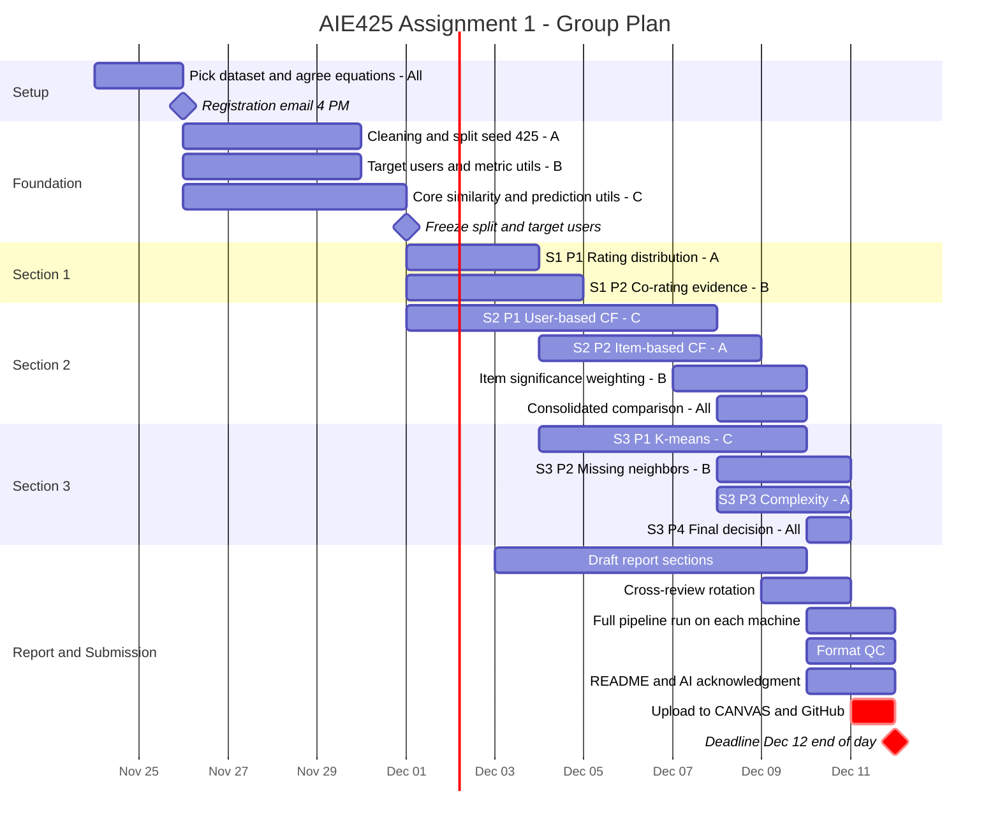

# Members

| Name | ID | Selected |
| --- | --- | --- |
| Ahmed Essa | 223106563 | A |
| Maryam Othman | 223105468 | B |
| Ahmed Allam | 223102168 | C |

The spec already defines three tracks plus shared work, but the tracks are not equal in effort, so you need to balance them with the shared work.

## 1. The built-in tracks, and how heavy they are

| Track | Parts | Rough effort |
|---|---|---|
| **A** | S1 P1 (rating stats) + S3 P3 (complexity) | Light to moderate. S1P1 is mostly descriptive statistics. |
| **B** | S1 P2 (co-rating) + S3 P2 (missing neighbors) | Moderate to heavy |
| **C** | S2 P1 (user-based CF, 3 case studies) + S3 P1 (K-means) | **Heaviest.** S2P1 is the core algorithm work, and S3 depends on it. |
| **D (all)** | S2 P2 (item-based), S3 P4, integration, report, README, QA, upload | Shared |

This is my judgment from the task counts, not an official weighting. The pattern is that **C is overloaded and A is lightest**. You fix this by giving A and B more of the shared Track D work and giving C very little of it.

## 2. Suggested split of the shared (Track D) work

| Shared item | Lead | Support |
|---|---|---|
| Data cleaning, 80/20/validation split (seed 425), sparse matrix | **A** | B reviews |
| Target-user selection (30 users) and MAE/RMSE/coverage utilities | **B** | A reviews |
| Core similarity and prediction functions in `utils/` | **C** | A and B review the math |
| S2 P2 item-based CF (implementation) | **A** | C supplies the best user-based config for comparison |
| S2 P2 item significance weighting and popular vs rare items | **B** | A reviews |
| S3 P4 final decision table | Draft by **B** | Everyone edits |
| Report: dataset and methodology, README, requirements.txt, repo structure, formatting | **A** | B proofreads |
| Report: comparative discussion and conclusions | **B** | C reviews |
| Report: executive summary, references, AI acknowledgment | **C** (short tasks) | Everyone checks |

The result is that A and B carry more shared work to offset C's heavier tracks.

## 3. Making everyone equally responsible

The split decides who writes things. These rules decide who answers for them.

- **Cross-review rotation (A→B→C→A).** Every part is reviewed by someone who didn't write it. They must re-run it and check the equations against the lecture definitions.
- **No merging without a second person's approval.** Use pull requests, and keep commits visible from all three people.
- **Walkthrough sessions.** Each person explains their own track to the other two, answering the Q-questions out loud. This also prepares you for Week 12, because the individual lab uses the group's dataset and code, and "inability to explain submitted results" can hurt your individual mark.
- **Everyone runs the full pipeline** end-to-end on their own machine before submission. This checks relative paths and requirements.txt, and nobody is left dependent on one person's setup.
- **Section 2 is the shared backbone.** Section 3 depends on the best similarity, β and k, so agree on those together.
- **Final QC in rotation.** Each person does one pass for equations, figures and interpretations, and one for formatting (Arial 12, 1.5 spacing, "Page X of Y").

## 4. Timeline

1. **By Thu Nov 26, 4 PM:** pick the dataset, assign tracks, and send the registration email. Assign tracks by strength and interest, and put your strongest coder and math person on **C**.
2. **Nov 26 to Dec 1:** build the shared foundation (A, B and C each own their piece above) and freeze the split and target users.
3. **Dec 1 to Dec 6:** each person works on their track. Section 2 results should land first, since Section 3 needs them.
4. **Dec 6 to Dec 9:** do the item-based work, final decision and cross-reviews.
5. **Dec 9 to Dec 11:** assemble the report, run QC, check the AI acknowledgment section, and upload both CANVAS and GitHub with a day to spare. The late penalty is severe.

## 5. Things to settle early

- Decide the exact equations (centering on full history vs. common ratings, handling of undefined values) **before anyone codes**, since the spec requires consistency across comparisons.
- Put name and ID at the top of every file.
- Q 2.8 repeats Q 2.4 word for word, so it's worth asking the TA whether that's a typo.

## planned timeline (gannt)



Notes on the plan:

- **`excludes`**  Saturdays and Sundays from the bars.
- **C starts S2 P1 immediately** after the foundation, since Section 3 needs the best similarity measure, β and k. The K-means feature work (S3 P1) can begin early because it only uses training data.
- **The Dec 12 deadline is a Saturday**, so the plan finishes uploads on Dec 11. The late penalty is 50%, and anything more than 24 hours late scores zero.
- **The Week 12 individual lab** isn't dated in the spec. Once you know the date, add a section for walkthrough sessions before it.

## Dataset Selected

<https://www.kaggle.com/datasets/odedgolden/movielens-1m-dataset/data?select=ratings.dat>

note: why not from <https://grouplens.org/datasets/movielens/>

the requirements document IS in fact AI generated and the URLs are not valid and result in:

```bash
$ curl https://grouplens.org/datasets/movielens/
curl: (28) Failed to connect to grouplens.org:443 after 7203 ms: Could not connect to server
```

## Proposed Stack

- python 3.13
- polars (pandas replacement)
- jax (tensorflow and pytorch replacement)
- numpy
